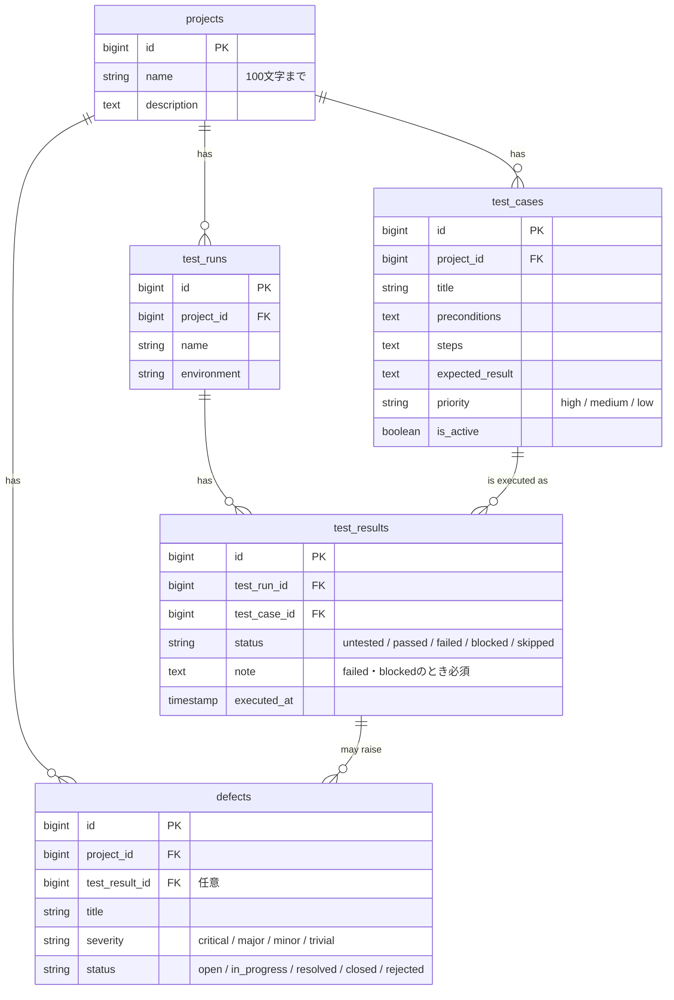

# ER図

- `test_results` は `(test_run_id, test_case_id)` に一意制約をかけ、1回のテスト実行で同じテストケースの結果が重複しないようにしています。
- プロジェクトを削除すると、配下のテストケース・テスト実行・不具合も削除されます（`cascadeOnDelete`）。
- テスト結果を削除しても不具合は残し、紐づけだけを外します（`nullOnDelete`）。
