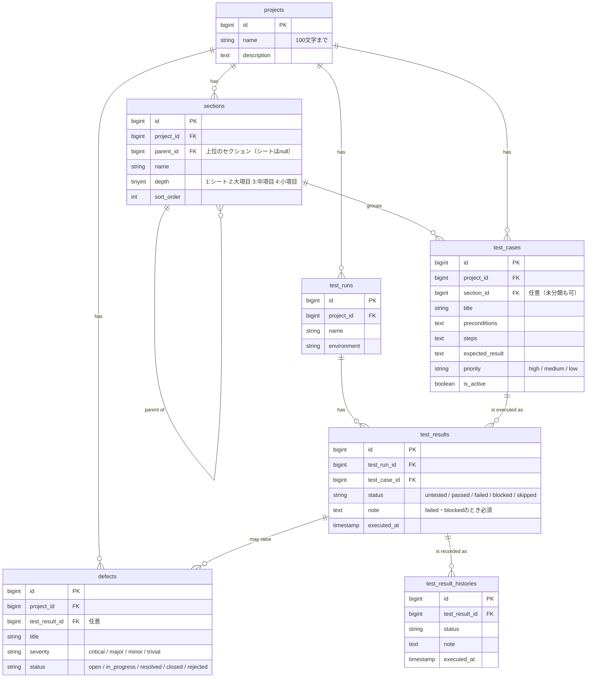

# ER図

- `sections` は自分自身を親に持つ構造で、「シート → 大項目 → 中項目 → 小項目」の4段まで作れます。
- `test_results` は最新の結果だけを持ち、記録のたびに `test_result_histories` へ1行追加します（NG → 修正 → 再テストで OK、という経緯を残すため）。
- セクションを削除すると下位のセクションも削除され、所属していたテストケースは「未分類」になります（`nullOnDelete`）。
- `test_results` は `(test_run_id, test_case_id)` に一意制約をかけ、1回のテスト実行で同じテストケースの結果が重複しないようにしています。
- プロジェクトを削除すると、配下のテストケース・テスト実行・不具合も削除されます（`cascadeOnDelete`）。
- テスト結果を削除しても不具合は残し、紐づけだけを外します（`nullOnDelete`）。
